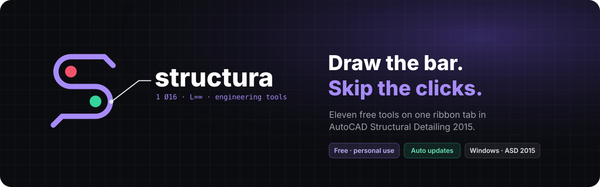
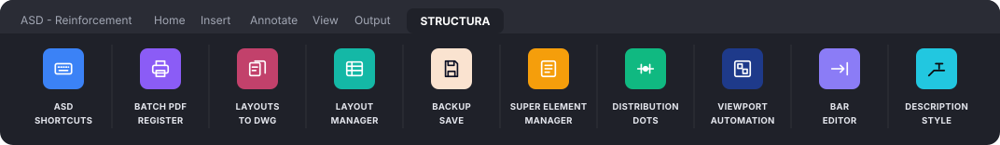
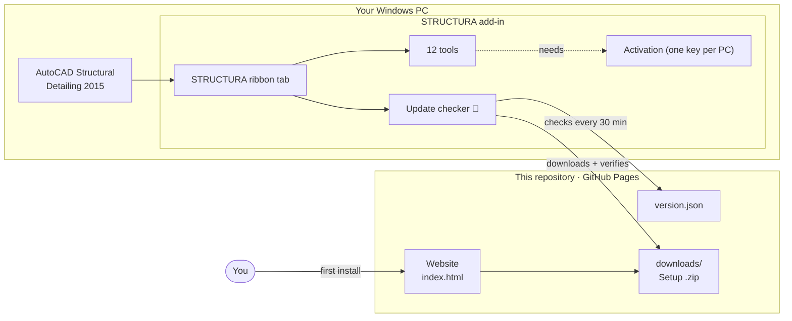
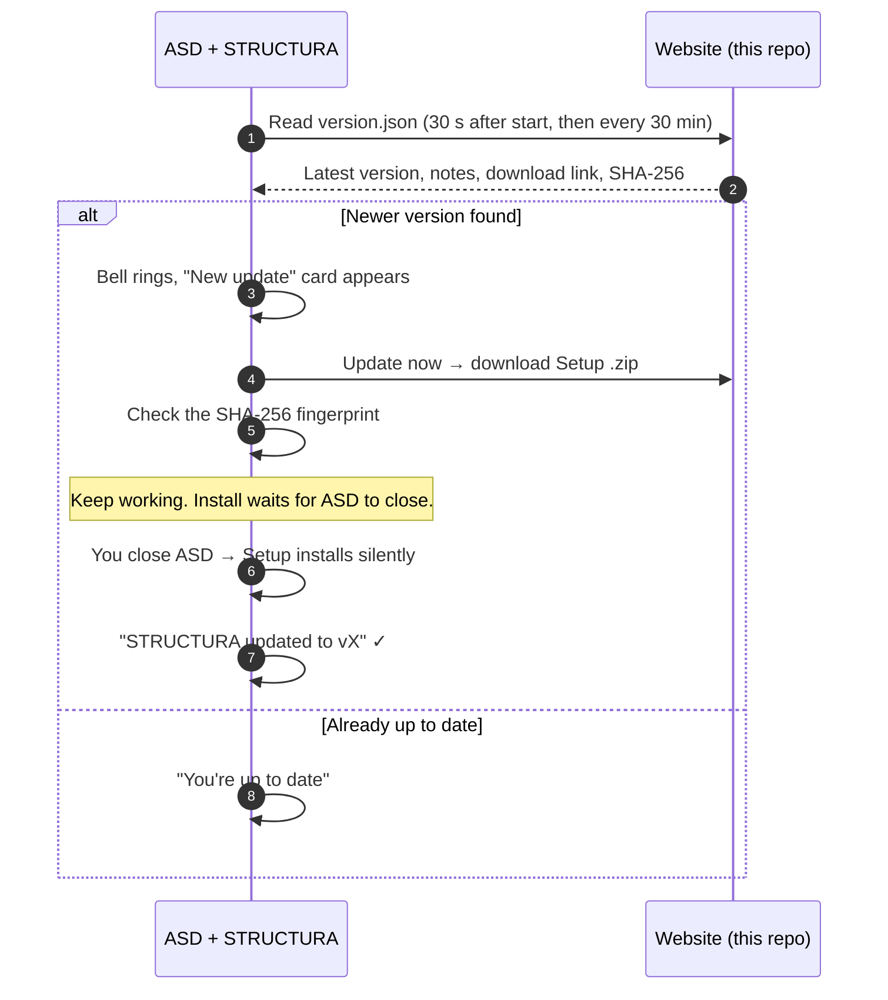

<p align="center">
  <a href="https://baraa2x-hub.github.io/STRUCTURA-ASD/"></a>
</p>

<p align="center">
  <a href="https://baraa2x-hub.github.io/STRUCTURA-ASD/"></a>
  
  
  
</p>

<p align="center">
  <a href="https://baraa2x-hub.github.io/STRUCTURA-ASD/"><b>🌐 Website</b></a> ·
  <a href="https://baraa2x-hub.github.io/STRUCTURA-ASD/#get"><b>⬇️ Download</b></a> ·
  <a href="#-the-tools"><b>🧰 Tools</b></a> ·
  <a href="#-how-updates-work"><b>🔔 Updates</b></a> ·
  <a href="https://www.linkedin.com/in/al-baraa-mohummed-826a96205"><b>in LinkedIn</b></a>
</p>

---

## What is STRUCTURA?

**STRUCTURA** is a free add-in for **Autodesk AutoCAD Structural Detailing 2015 (ASD)**, the program structural engineers use for reinforcement shop drawings and bar bending schedules.

ASD has not been updated since 2015, and many everyday jobs in it still take dozens of clicks. STRUCTURA adds **one ribbon tab with twelve tools** that turn those jobs into one or two clicks. Every tool was built by a working structural engineer to replace a step he kept repeating on real projects.

<p align="center"></p>

---

## 🧰 The tools

| | Tool | What it does |
|:-:|---|---|
|  | **ASD Shortcuts** | One short key runs a whole ASD command. 24 bar commands on keys you choose: type `RF` and ASD starts drawing a bar. Your list loads with ASD. |
|  | **Batch PDF Register** | Tick layouts in one drawing or many. Every sheet becomes its own PDF, named by your rules, with an Excel register at the end. |
|  | **Layouts to DWG** | Saves each layout as its own light, plain CAD file that opens anywhere, without ASD objects. Your drawing can stay open. |
|  | **Layout Manager** | Rename, number, reorder and add layouts in an Excel-like grid. Numbering takes letters too (A01, A02…). Nothing changes until you press Save. |
|  | **Backup Save** | Every save makes a numbered backup and keeps the last ten. A small reminder appears if you haven't saved in a while. |
|  | **Super Element Manager** | Name a detail, set how many there are, window-select its bars. Every position appears with its count and diameter, and Save writes it into ASD's own Element Manager. |
|  | **Distribution Dots** | Select bars with a crossing window, pick the distribution dimension, type the dot size. A clean donut lands on every crossing. |
|  | **Viewport Automation** `NEW` | Keep saved views in folders, each with its scale. Drag one onto a layout and a viewport is created at the right scale, zoomed and locked. |
|  | **Bar Editor** `NEW` | Join, split, extend and stretch real ASD bars from one floating toolbar, keeping bends and hooks. ASD can't do this on its own. |
|  | **Description Style** `NEW` | Edit ASD's reinforcement description styles in a live preview: click any part of the label, move it, add brackets, switch to two lines. |
|  | **Splice Maker** `NEW` | Bar longer than stock? Splits it into separate real ASD bars that overlap by the lap (60Ø or mm): equal, at the middle, full stock or your own lengths, touching or offset. Each piece gets its own description and lap dimension, in one undo. |
|  | **Beam Section** `NEW` `PRO` | Type the beam (Rect, L or T with slab) and its steel. Draws the concrete, real ASD stirrups, donut bars in layers, side bars, dimensions, labels and an auto-numbered title in one click, with bar spacing checked against ECP 203. |

---

## 🧩 How it fits together



- The add-in is written in **C# (.NET Framework 4.8, WPF)** and loads into ASD 2015 (64-bit) at startup.
- Every tool works on the open drawing through ASD's own API, so bars, descriptions and elements stay **real ASD objects**.
- Tools ask before changing anything, and Backup Save keeps copies of your work.

---

## 🔔 How updates work

You install STRUCTURA once. After that, new versions find you.



Your shortcuts, saved views, settings and activation are kept on every update.

---

## ⬇️ Install

1. Download the latest Setup from the **[website](https://baraa2x-hub.github.io/STRUCTURA-ASD/#get)** (or from [`downloads/`](downloads/)).
2. Unzip it and run **`STRUCTURA-ASD-Setup.exe`**. No admin rights needed.
   - Windows may show *"Windows protected your PC"*. Click **More info → Run anyway**. The setup is not code-signed yet.
3. Pick the tools you want and press **Install**.
4. Open ASD 2015. The **STRUCTURA** tab is on the ribbon.
5. Activate once with your key (ask the author on LinkedIn).

**Requirements:** Windows 10 or 11 · AutoCAD Structural Detailing 2015 (64-bit) · .NET Framework 4.8.

To uninstall, use **Windows Settings → Apps**, or the uninstaller next to the setup.

---

## 📦 What's in this repository

This repository holds the **public website and the release files only**. The add-in's source code is kept private.

```text
STRUCTURA-ASD/
├── index.html      → the website (served by GitHub Pages)
├── version.json    → latest version, read by the add-in's update check
├── downloads/      → the last ten Setup .zip files
├── assets/         → images used in this README
└── favicon.svg     → the STRUCTURA "S" mark
```

<details>
<summary><b>version.json format</b></summary>

```json
{
  "version": "1.9.38",
  "released": "2026-11-14",
  "download": "https://baraa2x-hub.github.io/STRUCTURA-ASD/downloads/STRUCTURA-ASD-Pro-Setup-v1.9.38.zip",
  "sha256": "…",
  "notes": ["What changed in this version"]
}
```

The add-in only installs a file whose SHA-256 matches this value.
</details>

---

## 👷 About the author

Made by **Eng. Al-Baraa Mohummed**, a structural engineer who draws reinforcement shop drawings in ASD every day.

<a href="https://www.linkedin.com/in/al-baraa-mohummed-826a96205"></a>

If STRUCTURA saves you time, a ⭐ on this repository helps other engineers find it.

---

<p align="center">
  © 2026 ENG/ AL-BARAA MOHUMMED · all rights reserved · free for personal use, no commercial use.<br>
  🇵🇸 From the river to the sea, Palestine will be free
</p>
